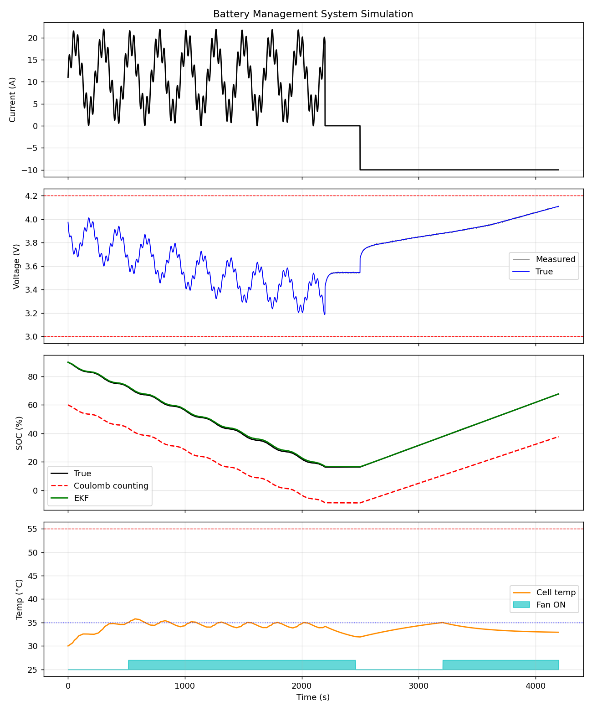

# Battery Management System (BMS) Simulation

A Python simulation of a Battery Management System that monitors the charge, health, voltage and temperature of a lithium-ion cell. It estimates State of Charge (SOC) and State of Health (SOH) and models thermal management with fan control and protection cut-offs.

## Features

- **Battery model:** 1-RC Thevenin equivalent circuit (R0, R1, C1) with a lookup-table OCV-SOC curve
- **SOC estimation:** Coulomb counting compared against an Extended Kalman Filter (EKF)
- **SOH estimation:** capacity-based, calculated from the EKF SOC change over a discharge segment
- **Thermal management:** lumped thermal model with I²R heating and hysteresis-controlled fan cooling
- **BMS protections:** over-voltage, under-voltage, over-current and over-temperature limits
- **Test profile:** dynamic discharge, rest period, then constant-current charge, with sensor noise and current-sensor bias

## How to Run

```bash
pip install numpy matplotlib
python bms_simulation.py
```

The script prints the results summary and saves the plots as `bms_results.png`.

## Results

| Metric | Result |
|---|---|
| SOC RMSE, Coulomb counting | 27.1 % |
| SOC RMSE, EKF | **0.50 %** |
| SOH, true vs. estimated | 92.0 % vs. 93.4 % |
| Peak temperature | 35.8 °C (ambient 30 °C) |
| Voltage range | 3.19 to 4.11 V |
| BMS state at end of run | Normal, no faults |



Coulomb counting drifts because of the wrong initial SOC and the current-sensor bias. The EKF corrects this using the voltage measurement and converges to the true SOC.

## Parameters

| Parameter | Value |
|---|---|
| Rated capacity | 10 Ah (true: 9.2 Ah, SOH 92 %) |
| R0 / R1 / C1 | 0.012 Ω / 0.008 Ω / 2500 F |
| Thermal capacity | 250 J/K |
| Thermal resistance | 4.0 K/W (natural), 1.4 K/W (fan on) |
| Fan on / off | 35 °C / 32 °C |
| Voltage limits | 3.0 V to 4.2 V |
| Current limit | 35 A |
| Over-temperature cut-off | 55 °C |

## Limitations and Future Work

- Single-cell model; a pack model would add series/parallel cells and cell balancing
- Fixed parameters; real cells vary with temperature and SOC
- Synthetic current profile; a standard drive cycle (e.g. UDDS) could be used
- SOH is capacity-based only; resistance-based SOH could be added
- Could be extended to Simulink or an embedded implementation

## Tools
python,numpy,matplotlib
